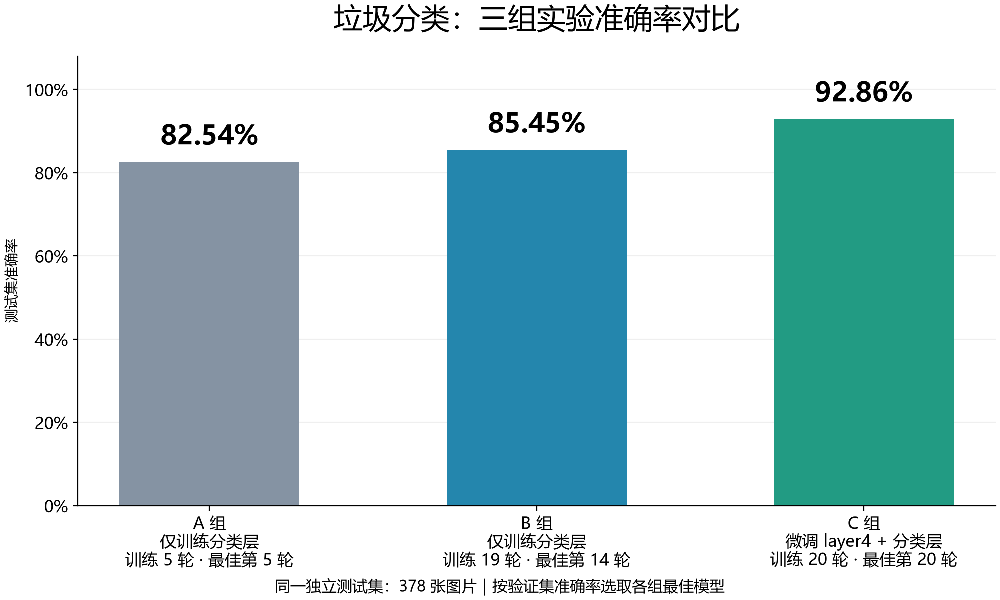

# 垃圾图像分类

基于 ResNet-18 的六分类项目，包含 Streamlit 演示和可追溯的 A/B/C 对照实验。标签为纸板、玻璃、金属、纸张、塑料、其他垃圾，不直接对应生活垃圾四分类。

## 项目结构

```text
GarbageClassification/
├── app.py                    # 上传图片、拍照和 Top-3 预测
├── model.py                  # ResNet-18 模型
├── train.py                  # A/B/C 训练、早停、持久化日志与恢复
├── evaluate.py               # 测试指标、逐图预测和实验对比表
├── plot_results.py           # 真实日志曲线和测试混淆矩阵
├── experiment_utils.py       # 配置验证、数据审计、原子写入
├── experiments/
│   ├── A.json
│   ├── B.json
│   └── C.json
├── data/
│   ├── raw/dataset-resized/   # 原始图片
│   └── split.csv             # 三组共用的固定划分
├── checkpoints/
│   └── best_resnet18.pth      # 页面使用的权重
├── tests/test_experiments.py
└── results/
    ├── runs/<A|B|C>/<run-id>/ # 每次运行独立保存，默认不提交中间文件
    └── final/                # 实际训练、评估、绘图后生成
        ├── comparison.csv
        ├── accuracy_comparison.png
        ├── training_curves.png
        ├── confusion_matrix.png
        ├── test_metrics.json
        └── training_logs/        # 已交付实验的配置、逐轮历史与日志
```

## 环境与页面

以下 PowerShell 命令在项目根目录执行，统一使用 `venv`。首次创建环境时执行 `python -m venv venv`。

```powershell
.\venv\Scripts\python.exe -m pip install -r requirements.txt
.\venv\Scripts\python.exe -m streamlit run app.py
```

打开终端显示的本地地址，通常是 `http://localhost:8501`，上传或拍摄图片后点击“开始预测”。实时视频入口暂由 `app.py` 中的 `ENABLE_LIVE_CAMERA = False` 关闭。

## A/B/C 实验设计

本次 `ppt_training` 实验在同一份 378 张独立测试图片上的结果如下，模型均按验证集准确率选择：

| 实验 | 实际训练轮数 | 最佳轮次 | 测试准确率 | Macro-F1 |
| --- | --- | --- | --- | --- |
| A | 5 | 5 | 82.54% | 0.8115 |
| B | 19（早停） | 14 | 85.45% | 0.8519 |
| C | 20 | 20 | 92.86% | 0.9257 |



C 相对 A 提高 10.32 个百分点。这是固定划分、单随机种子的比较。详细说明见 [comparison_notes.md](results/final/comparison_notes.md)，逐轮记录位于 [training_logs](results/final/training_logs)。交付目录不含三组模型检查点；页面仍使用 `checkpoints/best_resnet18.pth`，页面模型的指标不能直接写成 C 组测试结果。

| 实验 | 最大轮数 | 可训练部分 | 分类层学习率 | layer4 学习率 | 早停 |
| --- | --- | --- | --- | --- | --- |
| A | 5 | 仅 fc | 1e-3 | 不更新 | 关闭，保留短训练基线 |
| B | 20 | 仅 fc | 1e-3 | 不更新 | 验证准确率连续 5 轮无提升 |
| C | 20 | 前 3 轮仅 fc，之后 layer4 + fc | 1e-3 | 1e-4 | 微调阶段连续 5 轮无提升 |

三组分别从 ImageNet 预训练权重初始化，使用同一划分、种子 42、水平翻转增强和 AdamW，避免将延长训练与增强策略变化混为同一因素。默认微批次 4、梯度累积 4 次，有效批次约为 16；最后不足完整批次时按实际图片数量归一化。全部实验固定 BatchNorm 运行统计量，以适应小批次。

默认 `cache_features: true`：冻结主干时缓存原图和水平翻转图的 512 维特征，逐样本仍按同样的随机翻转规则选择视图，避免每轮重复计算固定卷积。缓存按主干参数、清单及图片内容哈希区分，只包含训练集与验证集，不含测试图片。C 解冻 `layer4` 后自动切回原始图片训练。构建缓存会保存并恢复随机状态，确保不改变训练的抽样与增强顺序。

训练集 1,765 张，验证集 378 张，测试集 378 张。新流程直接按 `data/split.csv` 读取原始图片，不依赖复制生成的 `train/val/test` 文件夹。启动时核对图片是否存在、类别是否齐全及跨集合内容重复，并记录清单和图片内容哈希。数据来源与排除项见 [data/README.md](data/README.md)。

```powershell
# 只检查配置和数据，不训练、不下载预训练权重
.\venv\Scripts\python.exe train.py --experiment all --dry-run

# 顺序执行三组，或将 all 换成 A、B、C 单独执行
.\venv\Scripts\python.exe train.py --experiment all

# 按需调整最大轮数、早停耐心或内存占用；最终配置会写入运行目录
.\venv\Scripts\python.exe train.py --experiment C --epochs 30 --patience 5 --batch-size 2 --accumulation-steps 8
```

也可编辑 JSON 或使用 `--config experiments/C.json`。设备按 CUDA、MPS、CPU 顺序选择，可通过 `--device cpu` 指定。首次正式训练可能下载 ImageNet 权重。

## 日志、模型和恢复

每次运行创建 `results/runs/<实验>/<run-id>/`，包含：

- `config.json`：合并命令行覆盖后的配置。
- `metadata.json`：初始化来源、种子所在配置、设备、开始时间、数据哈希与各类数量。
- `train.log`：训练进度和异常信息。
- `history.csv`、`history.json`：每轮训练/验证损失、准确率、验证 macro-F1、学习率和耗时。
- `best.pth`：仅按验证准确率选择的最佳模型。
- `last.pth`：最近完整轮次的模型、优化器、随机状态和历史。
- `status.json`：运行、暂停、完成、早停或失败状态。

检查点和结构化日志使用临时文件写入、flush/fsync 后原子替换。中断后从最近完整轮次继续，不会接着使用半轮更新。

```powershell
.\venv\Scripts\python.exe train.py --resume results/runs/C/<实际run-id>
```

可用 `--stop-after 1` 主动暂停并保存，之后用上述命令继续。恢复使用原配置，禁止同时覆盖参数；若图片、清单或配置改变，会拒绝恢复。新配置请开启新运行。相同 `run-id` 的新实验不能覆盖已有目录。

## 测试与绘图

完成训练和验证集选模后，再进行测试；训练循环不读取测试图片用于优化或选模。

```powershell
# 每组选择最近一次已完成的正式运行，评估其 best.pth
.\venv\Scripts\python.exe evaluate.py --experiments A B C

# 生成训练/验证损失、准确率曲线及各组测试混淆矩阵
.\venv\Scripts\python.exe plot_results.py
```

测试结果保存在各运行目录的 `test_metrics.json`，并汇总为 `results/final/test_metrics.json` 与 `comparison.csv`。包含准确率、macro precision/recall/F1、每类指标、混淆矩阵和逐图预测；对比表中的比例使用 0–1 数值。混淆矩阵为行真实类别、列预测类别。图表只使用已完成运行的真实记录，若最新训练和测试记录不匹配会提示先重新评估。

也可指定某次运行或外部权重：

```powershell
.\venv\Scripts\python.exe evaluate.py --run-dir results/runs/C/<实际run-id>
.\venv\Scripts\python.exe evaluate.py --checkpoint checkpoints/best_resnet18.pth --split val --output results/final/validation_external.json
```

新实验不会自动替换页面模型。确定使用某组最佳模型后，先备份页面权重，再将该运行的 `best.pth` 复制为 `checkpoints/best_resnet18.pth`；页面下一次预测按文件时间戳重新加载。

## 验证开发流程

```powershell
.\venv\Scripts\python.exe -m unittest discover -s tests -v
```

小样本端到端检查使用独立目录；以下使用随机初始化，仅验证流程，不是正式实验：

```powershell
.\venv\Scripts\python.exe train.py --experiment C --epochs 2 --warmup-epochs 1 --no-pretrained --max-train-samples 12 --max-val-samples 12 --output-root results/smoke --run-id check --stop-after 1
.\venv\Scripts\python.exe train.py --resume results/smoke/runs/C/check
.\venv\Scripts\python.exe evaluate.py --experiments C --results-root results/smoke --allow-smoke --max-samples 12
.\venv\Scripts\python.exe plot_results.py --results-root results/smoke --experiments C --allow-smoke
```

小样本运行在元数据、指标和图表中明确标记，默认正式汇总会排除它们。`finetune.py` 与此前的 `validation_baseline.json`、`finetuning_history.json` 是较早的探索记录，不属于 A/B/C 对照实验；原始随附权重缺少完整训练来源，不能将其验证指标直接当作独立测试准确率。新 A/B/C 均从已记录的初始化开始，不沿用该权重。
