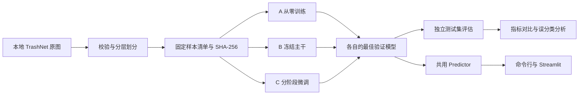

# 架构与实验规范

## 数据流

## 模块职责

入口脚本处理命令行参数，`garbage_classifier` 处理可复用逻辑，`models` 只负责网络与冻结规则。训练、评估和推理使用同一套 RGB、尺寸和标准化处理，训练阶段额外启用水平翻转与轻微旋转。模型权重自身携带类别顺序，不在界面中硬编码类别编号。

## 实验约定

| 项目 | 约定 |
| --- | --- |
| A | 随机初始化 ResNet-18，更新全网络 |
| B | ImageNet 预训练，只更新 fc，主干 BatchNorm 保持 eval |
| C | ImageNet 预训练，先更新 fc；再更新 layer4 和 fc，其余 BatchNorm 保持 eval |
| 最佳模型 | 验证集 Macro-F1 严格提升时保存，测试集不参与选择 |
| 优化器 | AdamW；C 中 fc 和 layer4 使用不同学习率，阶段切换时重新建立优化器 |
| 早停 | 连续 patience 轮未改善停止；C 的预热不触发早停，阶段切换重置等待计数 |
| 可复现性 | 固定 Python、NumPy、Torch 种子与样本清单；不同硬件/版本仍可能存在数值差异 |
| 公平性 | 同一数据、种子、图像尺寸、batch size、最大轮次和早停预算；实际轮次数单独报告 |
| 模型选择 | 课程分析以验证集选模型；测试集提供最终一次评价，避免反复据此调参 |

数据检查使用文件 SHA-256 检出完全相同的文件；不同编码、裁剪或相似场景的图片仍需人工检查。清单检查通过不等于已排除所有视觉近重复。

## 输出约定

数据报告保存在 `results/dataset`，每组实验的模型保存在 `checkpoints/<name>`，图表与指标保存在 `results/<name>`，汇总保存在 `results/comparison`。数据、权重、运行产物和虚拟环境通过 `.gitignore` 排除。空数据目录不会被 Git 跟踪，数据准备脚本会创建所需目录。

## 后续可扩展项

摄像头输入和 Grad-CAM 不属于当前基础流程。若添加其他网络，可沿用样本清单和报告格式，并为 checkpoint 增加网络架构字段，在 Predictor 中明确选择构建器。真实环境样本应单独保留，不混入当前测试集后继续调参。
